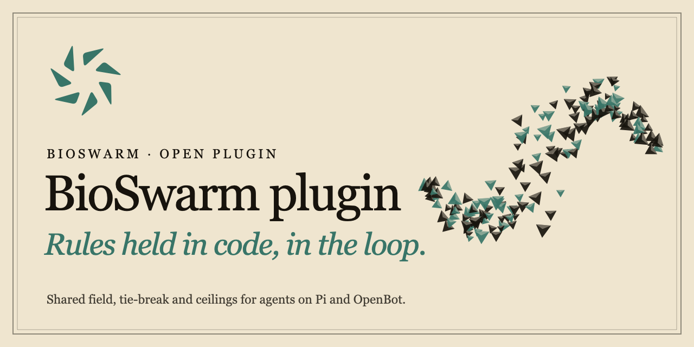
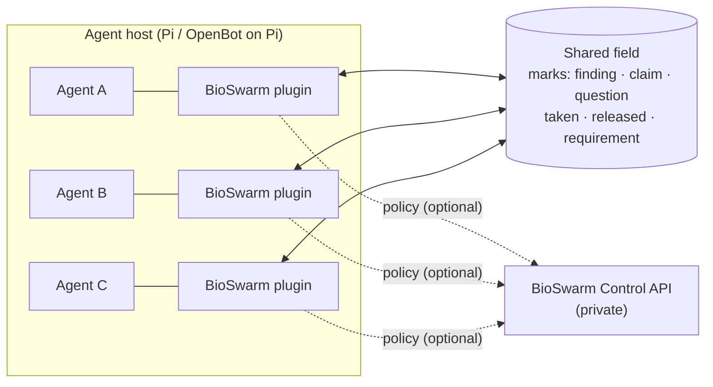

<p align="center">
  
</p>

<p align="center">
  <a href="LICENSE"></a>
  <a href="https://github.com/unfold-research/bioswarm/blob/main/protocol/bioswarm.v1.md"></a>
  
  
  <a href="https://github.com/unfold-research/bioswarm-plugin/actions/workflows/ci.yml"></a>
</p>

# BioSwarm plugin

**Bio-inspired coordination rules for teams of AI agents, enforced in code inside the agent loop.**

The BioSwarm plugin is the open half of [BioSwarm](https://github.com/unfold-research/bioswarm), the coordination engine
of [Colony](https://unfold.host/colony/). It runs inside the agent host, today [Pi](https://github.com/earendil-works/pi)
and OpenBot agents on the Pi provider, and turns a few coordination rules into code that the agent cannot talk its way
around.

Why code and not a prompt? It is the first thing [Unfold Research](https://github.com/unfold-research/bioswarm/tree/main/research)
measured: a rule binds only when code applies it to the state of the work. Written in an instruction file, it is advice.

> [!NOTE]
> Pre-release (0.4.0). The interface may change between minor versions. The hash tie-break is on by default once a
> wave is published; waiting for an addressed trace is experimental and off by default. See [What the research says](#what-the-research-says) before you expect any gain.

## Contents

- [What it does](#what-it-does)
- [Quick start](#quick-start)
- [Configuration](#configuration)
- [Community policy and the Control API](#community-policy-and-the-control-api)
- [Privacy](#privacy)
- [What the research says](#what-the-research-says)
- [Compatibility](#compatibility)
- [Development](#development)

## What it does



The plugin does nothing unless the agent's folder holds a `.bioswarm` file, so you can switch one agent on without
touching the others.

| Rule | What it does |
|---|---|
| **Shared field** | `leave_mark` / `read_marks`: agents leave findings, claims, questions, requirements and file locks in a field every agent reads, the way ants leave trails, instead of long messages to each other |
| **Message ceilings** | one short message to another agent per request (600 characters by default), a pointer and not the context; the detail goes to the field |
| **Taken files** | a file taken by another agent is put back after any tool that changed it, the shell included |
| **Spending ceiling** | after the request's budget, no further tool runs and the agent has to answer |
| **Hash tie-break** | when two agents reach for the same check, one is the designated writer and the other yields, without blocking anyone ([waves](docs/WAVES.md)) |
| **Acceptance gate** | optional, off by default: asks for another round when tests are missing or a check fails, up to a limit |
| **Addressed trace** | experimental, off by default: the owner of a check waits for a requirement from the teammate who needs it |

Agents get three tools: `leave_mark`, `read_marks` and `coordination_status` (who is the assigned writer of each check
in the current wave). When a team reaches its messaging ceiling, agents keep going through the field.

## Quick start

Requires Node.js 22 or later and [Pi](https://github.com/earendil-works/pi) 1.5.2 or later (or OpenBot 0.69+ with the
agent on the Pi provider).

```sh
npm install -g github:unfold-research/bioswarm-plugin

bioswarm-pi install                    # links the plugin into ~/.pi/agent/extensions/bioswarm
bioswarm-pi on  path/to/agent-folder   # writes path/to/agent-folder/.bioswarm
bioswarm-pi status                     # lists agents with BioSwarm on and their event counts
bioswarm-pi off path/to/agent-folder
```

Start a new chat with each agent you switched on. Every agent switched on shares one field: in OpenBot, the server's
`Shared/bioswarm/` folder; elsewhere, `.bioswarm-field/` in the agent folder unless you set `field`.

> [!TIP]
> Before using the tie-break or trace rules, publish the first wave of checks
> (`bioswarm-pi wave <wave-directory> <observation.json>`). See [docs/WAVES.md](docs/WAVES.md).

## Configuration

`.bioswarm` may hold JSON. Local settings override the policy, except the budget: a local budget can only lower the
remote one, so the person on the machine always keeps the brake.

```json
{ "runBudgetUsd": 3, "messagesPerRun": 1, "messageChars": 600, "messagesPerSession": null, "gate": null }
```

| Key | Default | Meaning |
|---|---|---|
| `runBudgetUsd` | `3` | spending ceiling per request, in US dollars of model usage |
| `messagesPerRun` | `1` | messages to other agents per request |
| `messageChars` | `600` | longest message to another agent |
| `messagesPerSession` | `null` | optional ceiling across a whole chat |
| `gate` | `null` | acceptance gate: `{ dir, command, checks, packages, rounds, timeoutMs }` |
| `tieBreak` | `"hash"` without a key, else from policy | the hash tie-break on published waves; `null` turns it off |
| `waitForTrace` | `false` | experimental addressed-trace rule |
| `fallbackAfter` | from policy, else the wave, else `3` | waves before an unchanged single check is reassigned to an outside teammate (needs the tie-break, not trace waiting) |
| `field` | host shared folder | path of the shared field |
| `apiUrl` | none | BioSwarm Control API endpoint |

## Community policy and the Control API

The plugin is open; the choice of coordination strategy is a service. With `BIOSWARM_API_KEY` set, the plugin fetches a
policy from the BioSwarm Control API at the start of each run (protocol
[`bioswarm.v1`](https://github.com/unfold-research/bioswarm/blob/main/protocol/bioswarm.v1.md)), caches it, and never
blocks the agent on the network. Without a key, or offline, it runs the **community policy**: the lab's published
defaults above. A remote policy can only set the rule keys listed in the protocol; anything else is ignored, so a
policy cannot reach outside the loop.

## Privacy

Telemetry goes to the Control API only when you set a key. It carries kinds, tool names, counts and costs: never
prompts, messages, file contents or paths (`policy.js`, `scrubEvent`). Locally, the plugin keeps an event record in
`<agent>/.bioswarm-events.jsonl` with the same rule.

## What the research says

Every rule here comes from a preregistered study published in
[unfold-research/bioswarm](https://github.com/unfold-research/bioswarm/tree/main/research), failures included. In
short, and with the caveats of [`FINDINGS.md`](https://github.com/unfold-research/bioswarm/blob/main/research/FINDINGS.md):

- **Leaderless conversation cannot coordinate coupled work; any arbiter cures the oscillation.** That is why the field
  replaces messages and why there is a tie-break.
- **Follow-up studies refuted** that the acceptance gate (H-H04) or an independent verifier (H-H05) improve outcomes.
  The gate stays available and off by default.
- **Waiting for a requirement trace** reached zero failing checks in fewer coordination waves than a manager agent on
  synthetic 160-module tasks, on two model families with one model each, with final quality not separated. Wave
  counts include the manager's planning waves and elapsed time was not verified. It remains an experimental opt-in.
- **In BioSwarm's own field tests** (a simulated multichannel retail close, phases 1b and 1b-r), the arm with addressed
  traces and tie-break finished later than the shared field alone in most pairs and was not cheaper. Internal reports,
  not independently reviewed: [1b](https://github.com/unfold-research/bioswarm/blob/main/results/phase1b/REPORT.md) ·
  [1b-r](https://github.com/unfold-research/bioswarm/blob/main/results/phase1b-r/REPORT.md). Hence the recommended
  policy: shared field plus hash tie-break, trace waiting off.

Nothing here claims that a team with these rules is faster, cheaper or better than a single agent or a manager agent
on your work. That is the question the lab is studying, in the open.

## Compatibility

Plugin 0.3.1 · protocol `bioswarm.v1` · checked 2026-11-26 UTC. Full table: [COMPAT.md](COMPAT.md).

| Host | Version | Result |
|---|---|---|
| Pi | 1.5.2 (pinned), 1.6.1 (latest) | Pi session and policy suite pass |
| OpenBot | 0.78.0 (pinned), 0.80.0 (latest) | pending real Docker smoke |

## Development

```sh
git clone https://github.com/unfold-research/bioswarm-plugin
cd bioswarm-plugin
npm install
npm test        # real Pi sessions with a fixture model; no API key, no network
```

The field, wave and policy logic is in `coordination.js` and `policy.js`; the Pi wiring is in `index.js`. Releases
follow the [BioSwarm versioning rules](https://github.com/unfold-research/bioswarm/blob/main/docs/VERSIONING.md).

Every commit passes a leak check (pre-commit hook turned on by `npm install`, and a required `leak-check` workflow):
no secrets, personal data or private references, and GitHub noreply commit e-mails only. Contributions are welcome: read [CONTRIBUTING](https://github.com/unfold-research/.github/blob/main/CONTRIBUTING.md)
and report vulnerabilities privately as described in [SECURITY](https://github.com/unfold-research/.github/blob/main/SECURITY.md).

## License

[Apache-2.0](LICENSE) © Unfold Research. Part of [BioSwarm](https://github.com/unfold-research/bioswarm), by
[Unfold](https://unfold.host).
